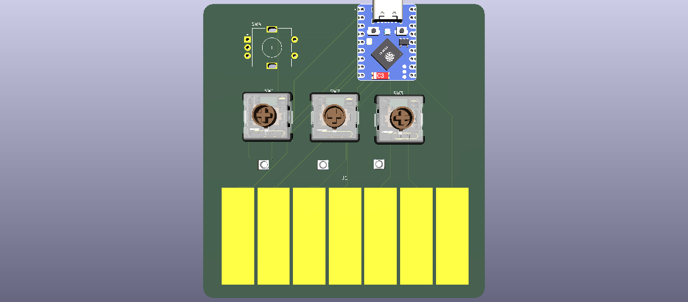
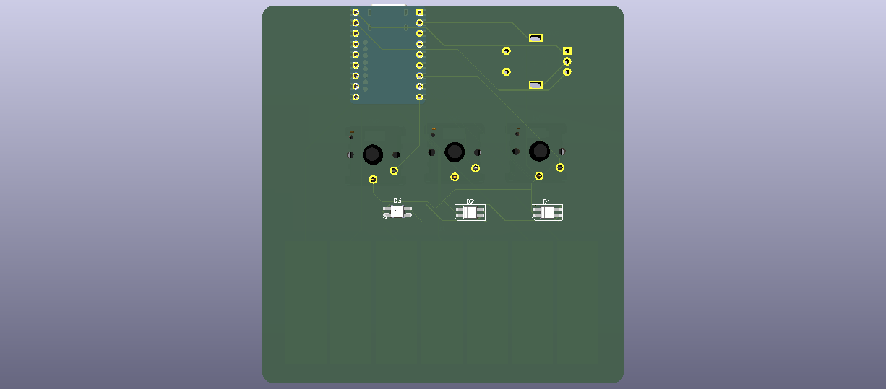

# MIDI Keyboard

A USB MIDI controller on a custom PCB. Touch the copper keys to play notes, press the switches for drums, and turn the knob for volume.

It plugs into a computer over USB-C and shows up as a MIDI instrument, so it works with music software like FL Studio, Ableton or LMMS.

## How it works

The 7 piano keys are bare copper pads on the PCB. The ESP32-S3 measures their capacitance, so when your finger touches a pad it detects the change and sends a MIDI note. The 3 Choc switches send drum notes, the rotary encoder changes the computer's volume, and 3 RGB LEDs mounted on the back shine through holes in the board.

## Why I made it

I wanted to learn PCB design from start to finish: drawing a schematic, making a custom footprint, laying out and routing a board, and getting it ready to manufacture. A MIDI keypad was a fun way to do that, because at the end I get a real instrument I can make beats with.

## Features

- 7 capacitive touch keys (C major scale, MIDI notes 60-71)
- 3 Kailh Choc low-profile switches (kick, snare, hi-hat)
- 1 EC11 rotary encoder (computer volume)
- 3 SK6812MINI-E RGB LEDs, reverse-mounted to shine through the board
- Waveshare ESP32-S3-Zero, plugs in over USB-C

## Pin map

| Part | Pins |
|---|---|
| Touch keys 1-7 | GP13, GP12, GP11, GP10, GP9, GP8, GP7 |
| Switches SW1-SW3 | GP4, GP5, GP6 |
| Encoder A / B | TX (GPIO43) / RX (GPIO44) |
| LED data | GP3 |
| LED power | 5V |

## Files

- `PCB/` KiCad project (schematic, board, custom touch-key footprint)
- `PCB/production/` Gerber zip, BOM and positions for JLCPCB
- `firmware/code.py` KMK firmware
- `BOM.csv` parts list with prices and links

## Firmware setup

1. Install CircuitPython for the Waveshare ESP32-S3-Zero.
2. Copy the `kmk` folder from [KMK](https://github.com/KMKfw/kmk_firmware) and the `adafruit_midi` library onto the board.
3. Copy `firmware/code.py` onto the board.
4. Don't touch the keys while it boots: the touch pads calibrate at startup.

## Credits

Based on [Kai Pereira's MIDI keypad tutorial](https://github.com/KaiPereira/MIDI-Keypad).
